<!--
  GitHub profile README for https://github.com/rajulodh
  Setup: create a PUBLIC repository named exactly "rajulodh", then add this README.md
  and the assets/ folder to its root.

  Before publishing, replace the three TODO items:
    1. Email address and LinkedIn URL in the "Contact" section at the bottom.
    2. The Nexus and BlinxAI links (currently pointing at your repositories tab).
    3. The Face Attendance source link (see the comment inside that table cell).
-->

<a href="#selected-work">Work</a> &nbsp;·&nbsp; <a href="#stack">Stack</a> &nbsp;·&nbsp; <a href="#how-i-work">How I work</a> &nbsp;·&nbsp; <a href="#contact">Contact</a>

 

## About

I'm a software developer with an MCA from Chandigarh University, working across the stack with Java, Python and TypeScript. My projects cover REST APIs, real-time messaging, AI integrations and automated testing, and I deploy them rather than leaving them on localhost.

I'm currently strengthening my Java and data structures and algorithms while I keep polishing my full-stack projects, and I'm looking for an entry-level Associate Software Engineer role.

 

## Selected work

<table>
  <tr>
    <td width="50%" valign="top" align="center">
      
       
      <!-- TODO: replace with the exact repository URL, e.g. https://github.com/rajulodh/nexus -->
      <a href="https://github.com/rajulodh?tab=repositories">Source</a>
    </td>
    <td width="50%" valign="top" align="center">
      
       
      <!-- TODO: replace with the exact repository URL, e.g. https://github.com/rajulodh/blinxai -->
      <a href="https://github.com/rajulodh?tab=repositories">Source</a>
    </td>
  </tr>
  <tr>
    <td width="50%" valign="top" align="center">
      
       
      <a href="https://task-management-tau-rust.vercel.app/">Live demo</a>
    </td>
    <td width="50%" valign="top" align="center">
      
       
      <!-- TODO: add "Source" only if the repository is yours (your own repo or a fork with your changes). -->
      <a href="https://face-attendance-hnic.onrender.com/">Live demo</a>
    </td>
  </tr>
</table>

 

## Stack

  

 

## How I work

  

 

## Contact

<!-- TODO: put your real email and LinkedIn URL below. -->
**Email** [YOUR_EMAIL@example.com](mailto:YOUR_EMAIL@example.com) &nbsp;·&nbsp; **LinkedIn** [linkedin.com/in/YOUR_LINKEDIN](https://www.linkedin.com/in/YOUR_LINKEDIN/) &nbsp;·&nbsp; **GitHub** [@rajulodh](https://github.com/rajulodh)
